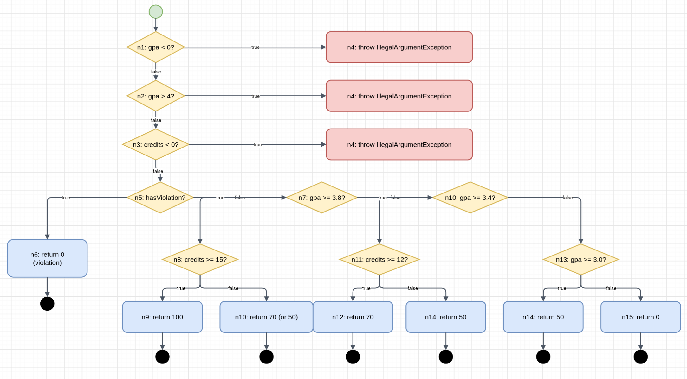

# Лаборатори №9 — JaCoCo код хамралт

**Оюутны нэр:** Д. Дэлгэрмаа  
**Оюутны код:** B232270035

## Орчны хувилбар

`java -version` гаралт:

```text
openjdk version "21.0.12.1" 2026-08-18
OpenJDK Runtime Environment (build 21.0.12.1+1-1-deb13u1-Debian)
OpenJDK 64-Bit Server VM (build 21.0.12.1+1-1-deb13u1-Debian, mixed mode, sharing)
```

`mvn -version` гаралт:

```text
Apache Maven 3.9.9
Maven home: /usr/share/maven
Java version: 21.0.12.1, vendor: Debian, runtime: /usr/lib/jvm/java-21-openjdk-amd64
Default locale: en_US, platform encoding: UTF-8
OS name: "linux", version: "6.12.111+deb13-amd64", arch: "amd64", family: "unix"
```

## A. Эхний хэмжилт

Happy-path 5 тестээр (`letterGradeA`, `letterGradeB`, `letterGradeC`, `gpaAverage`, `scholarshipFullAward`) Line хамралт **60.0%** (15/25), Branch хамралт **46.3%** (19/41) гарсан. Тоонууд `results/jacoco-A.csv`-ээс авсан, `results/mvn-verify-A.txt`-д `Tests run: 5`. Тайланд шар ромбо бүхий мөрүүд нь нийлмэл нөхцөлийн зөвхөн нэг тал нь хамрагдсаныг, улаан мөрүүд нь `IllegalArgumentException` шидэх алдааны замууд, D/F дүн, `gpa()`-ийн switch-ийн C/D/default тал, тэтгэлгийн 50 ба 0 буцаах мөрүүд огт хүрээгүйг харуулсан.

## B. Control Flow Graph ба Branch 100%

`scholarship()`-ийн CFG-г гараар зурсан (`cfg.png`). Шийдвэр бүрийн true/false ирмэг дээр түүнийг дайрах тестийн method нэрийг тэмдэглэсэн.

| Шийдвэр | Нөхцөл | true ирмэг дээрх тест | false ирмэг дээрх тест |
| :--- | :--- | :--- | :--- |
| 1 | `gpa < 0 \|\| gpa > 4 \|\| credits < 0` | `scholarshipRejectsNegativeGpa`, `scholarshipRejectsGpaAboveMaximum`, `scholarshipRejectsNegativeCredits` | `scholarshipFullAward` гэх мэт хүчинтэй оролтууд |
| 2 | `hasViolation` | `scholarshipViolationGetsNoAward` | `scholarshipFullAward` |
| 3 | `gpa >= 3.8 && credits >= 15` | `scholarshipFullAward` | `scholarshipFullGpaWithInsufficientCreditsGetsNoFullAward` |
| 4 | `gpa >= 3.4 && credits >= 12` | `scholarshipSeventyPercentAward` | `scholarshipGpaQualifiesButCreditsDoNot` |
| 5 | `gpa >= 3.0` | `scholarshipFiftyPercentAward` | `scholarshipBelowMinimumGetsNoAward` |



100% хүрэхэд нийт **21 тест** шаардагдсан (`results/mvn-verify-B.txt`: `Tests run: 21`). `results/jacoco-B.csv`-д `BRANCH_MISSED=0`, `LINE_MISSED=0` (Branch 41/41, Line 25/25). Эхний `||` нөхцөл бүрийг тусдаа `assertThrows` тестээр хамруулсан, учир нь JaCoCo нөхцөл бүрийг тусдаа салаа гэж тоолдог.

## C. Давталтын заагийн тестүүд

`gpa()`-ийн давталтад 0 / 1 / 2+ дүрмийг хэрэгжүүлсэн: хоосон массив ба `null` (`loopBoundaryZeroScoresRejectsEmptyArray`, `loopBoundaryZeroScoresRejectsNullArray`, `assertThrows`), нэг дүн (`loopBoundaryOneScore`: `gpa([95]) == 4.0`), олон дүн (`loopBoundaryMultipleScores`: `gpa([95, 85, 75, 65]) == 2.5`). Эдгээр тест хамралтын тоог өсгөөгүй ч хэрэгтэй: хамралт нь давталт хэдэн удаа гүйснийг ялгадаггүй бол эдгээр тест хоосон оролт, нэг элементийн хариу, голчийн хуваагчийг шалгадаг.

## D. Хамралт 100%, гэхдээ алдаа амьд

Спецификаци: 60–69.99 оноо "D". Зааг утгын 7 тест (60, 59.99, 69.99, 0, 100, 89.99, 90) нэмж `mvn test` ажиллуулахад `boundaryScoreSixtyIsD` тест унасан (`results/mvn-test-D-fail.txt`):

```text
expected: <D> but was: <F>
```

Алдаа нь `letterGrade`-д `if (score > 60) return "D";` гэж бичигдсэнд байсан, тул яг 60 оноо "F" болж байв. Спецификаци 60-г D гэж заасан тул `score >= 60` болгож тусдаа commit-оор зассан (`Fix letterGrade: > 60 -> >= 60, spec says 60 is D`). Засварын дараа **32 тест** бүгд ногоон болж, `results/jacoco-final.csv`-д `BRANCH_MISSED=0`, `LINE_MISSED=0` хэвээр байна (`results/mvn-verify-final.txt`).

Branch хамралт 100% байхад энэ алдаа үл үзэгдэх байсан, учир нь `score > 60` ба `score >= 60` хоёр нь ижил хоёр салааг (true, false) үүсгэдэг. 65 оноо true салааг, 50 оноо false салааг хамруулахад хоёр хувилбар хоёулаа 100% хамралт өгдөг; ялгаа нь зөвхөн яг 60 гэсэн нэг утганд л гарна. Хамралт нь кодын аль мөр, салаа ажилласныг хэмждэг боловч гарсан үр дүн спецификацитай таарч байгааг хэмждэггүй, мөн буруу харьцуулах оператор эсвэл хэрэгжүүлээгүй шаардлагыг мэддэггүй. Иймээс хамралт нь тестийн дутагдлыг харуулах хэрэгсэл болохоос кодыг зөв гэдгийн нотолгоо биш.

